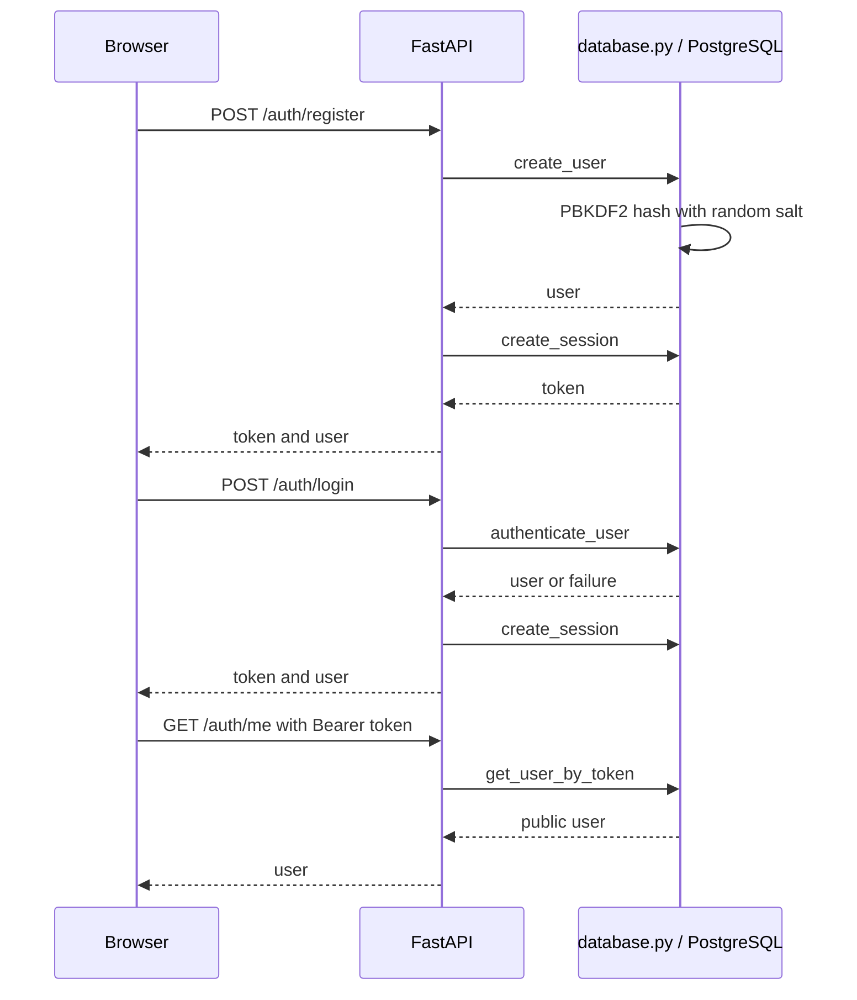
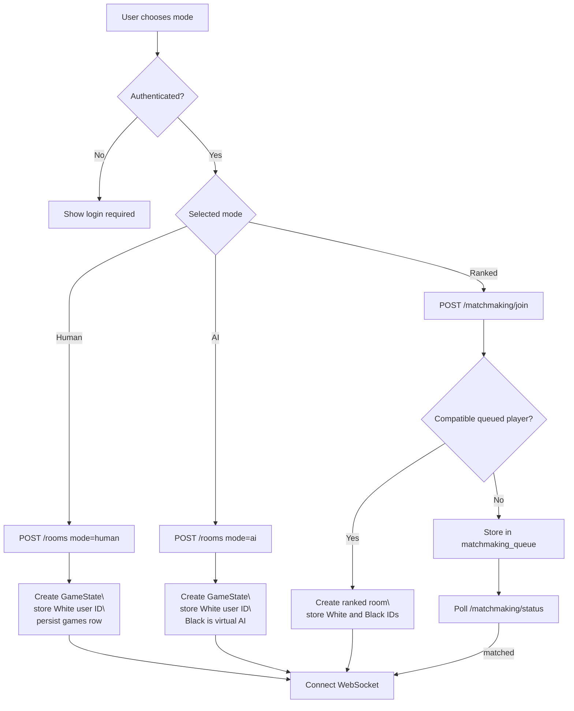
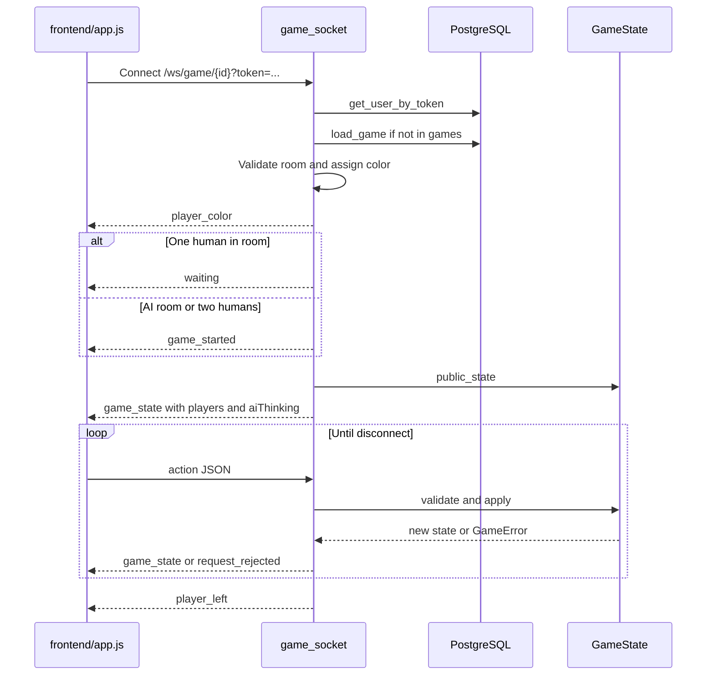
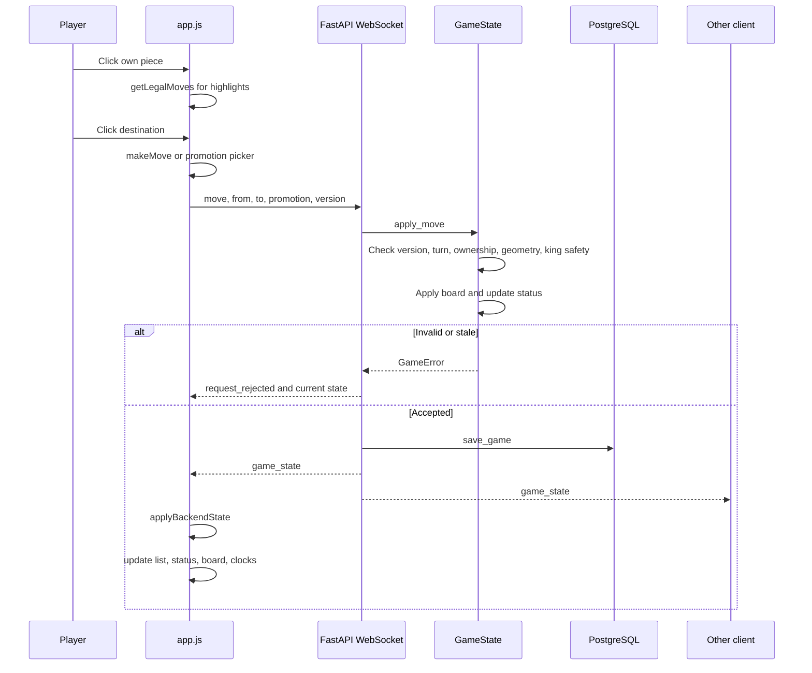
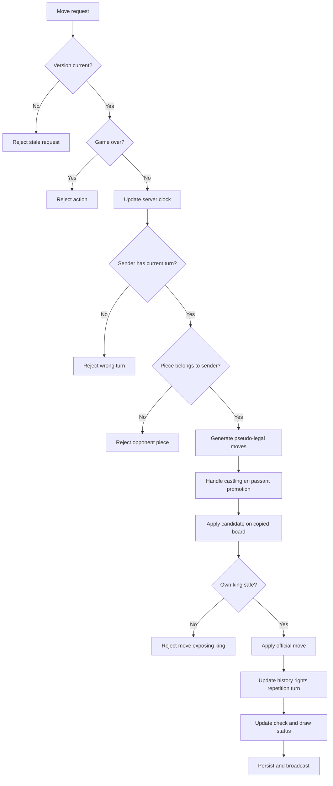
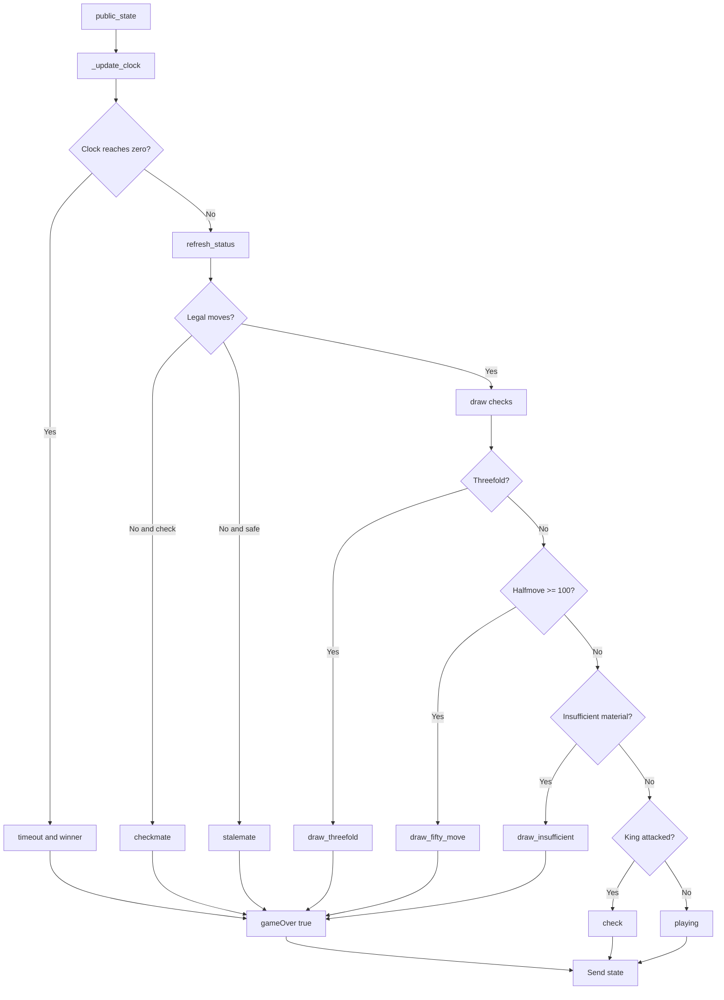
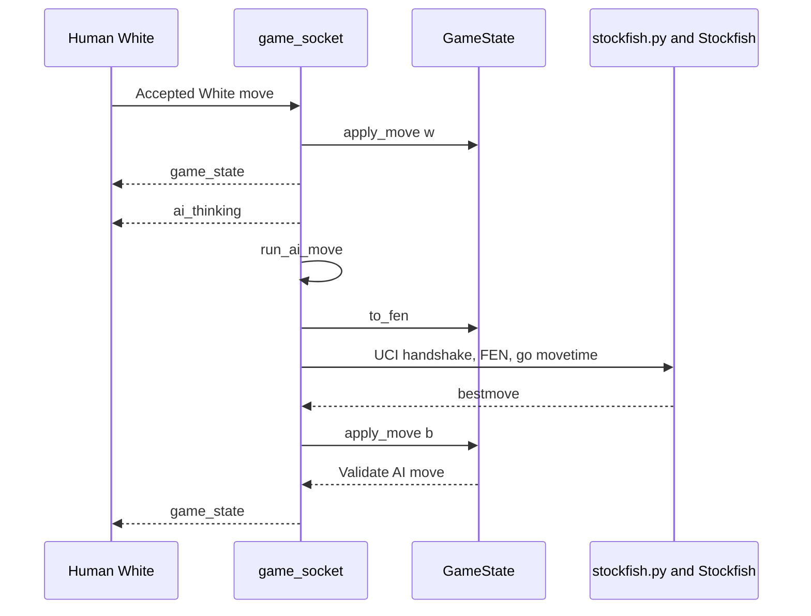
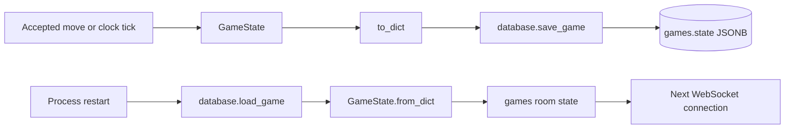

# Chess Application Architecture

This document describes the architecture currently implemented in this repository. It names the real files, functions, state objects, routes, and WebSocket messages rather than describing a future design.

## 1. System overview

```mermaid
flowchart LR
    Browser[Browser<br/>frontend/index.html<br/>frontend/app.js<br/>frontend/styles.css]
    HTTP[FastAPI HTTP routes<br/>backend/main.py]
    WS[WebSocket<br/>/ws/game/{game_id}]
    Domain[GameState<br/>backend/game.py]
    Memory[Process memory<br/>rooms, games, metadata]
    DB[(PostgreSQL<br/>users, sessions, games, queue)]
    Engine[Stockfish subprocess<br/>engine/stockfish/stockfish]

    Browser -->|fetch auth rooms matchmaking| HTTP
    Browser <-->|JSON messages| WS
    WS --> SocketHandler[game_socket()]
    SocketHandler --> Memory
    SocketHandler -->|validate and apply| Domain
    SocketHandler -->|save and load| DB
    SocketHandler -->|FEN search| Engine
    Engine -->|UCI bestmove| SocketHandler
    Domain -->|public_state| SocketHandler
    SocketHandler -->|game_state and clock_update| Browser
```

### Authority boundaries

| Component | Responsibility | Authority |
| --- | --- | --- |
| frontend/index.html | Board and control markup | None |
| frontend/app.js | Rendering, clicks, highlights, WebSocket client | UI copy only |
| frontend/styles.css | Layout and visual presentation | None |
| backend/main.py | HTTP, WebSocket, rooms, clocks, AI orchestration | Transport and room authority |
| backend/game.py | Chess rules and official state | Game authority |
| backend/database.py | Users, sessions, saved snapshots, matchmaking | Durable storage |
| backend/stockfish.py | UCI engine integration | Move suggestion only |

The browser may calculate legal-looking highlights, but the backend validates the submitted move again. A client cannot become authoritative by sending a different board.

## 2. Repository structure

```text
chess/
├── backend/
│   ├── main.py          FastAPI routes, WebSockets, rooms, clocks, AI
│   ├── game.py          Server-authoritative chess rules and state
│   ├── database.py      PostgreSQL repository and authentication
│   ├── stockfish.py     UCI adapter for the Stockfish process
│   └── test_game.py     GameState unit tests
├── frontend/
│   ├── index.html       Board and panel markup
│   ├── app.js           Browser controller and WebSocket client
│   └── styles.css       Board, panel, result, and responsive styles
├── engine/stockfish/    Local Stockfish binary/source when available
├── requirements.txt     Python dependencies
├── .env.example         Environment-variable example
├── Readme.md            Setup and feature guide
└── architecture.md     This detailed architecture document
```

### backend/main.py

This is the application composition and transport layer. It:

- Creates the FastAPI app.
- Defines authentication, room, and matchmaking endpoints.
- Mounts frontend as the static web root.
- Authenticates WebSocket tokens.
- Assigns player colors.
- Stores live room and socket membership.
- Converts WebSocket actions into GameState calls.
- Broadcasts accepted states.
- Runs the server clock loop.
- Starts and coordinates Stockfish.
- Saves game snapshots to PostgreSQL.

Process-local structures:

```python
rooms: dict[str, set[WebSocket]]
games: dict[str, GameState]
room_meta: dict[str, dict]
player_info: dict[str, dict[WebSocket, dict]]
room_state_locks: dict[str, asyncio.Lock]
ai_rooms_running: set[str]
```

These structures belong to one Python process. They are not shared between multiple Uvicorn workers.

### backend/game.py

GameState is the domain model and the final chess authority. It contains the board, turn, history, version, special-move metadata, clocks, draw offer, and terminal result.

Public methods include:

- public_state: JSON-friendly state for clients.
- apply_move: version, ownership, turn, geometry, king-safety, and promotion validation.
- legal_moves and all_legal_moves: legal move generation.
- to_fen: position conversion for Stockfish.
- undo, reset, resign, offer_draw, answer_draw: game actions.
- refresh_status: status repair/recalculation.
- to_dict and from_dict: PostgreSQL snapshot serialization.

### backend/database.py

This module owns PostgreSQL access for:

- Account creation and PBKDF2 password verification.
- Session token creation and lookup.
- User lookup by ID for opponent display.
- Saved game insertion and loading.
- Ranked matchmaking queue operations.
- Ranked Elo updates.

init_database creates tables during FastAPI startup. There is no migration tool.

### backend/stockfish.py

This module starts and controls the UCI engine:

1. Start the executable.
2. Wait for uciok.
3. Set two threads and 128 MB hash.
4. Wait for readyok.
5. Send the current FEN and go movetime.
6. Wait for bestmove.
7. Close the process.

The adapter default is 3000 ms. STOCKFISH_MOVE_TIME_MS overrides it. The .env.example file currently shows 2000 ms, so loading that value makes games use 2 seconds.

### frontend files

- frontend/index.html defines the board, player rows, clocks, status card, room/auth controls, move list, action buttons, promotion picker, and result overlay.
- frontend/app.js renders the board, handles clicks, calculates local highlights, sends WebSocket actions, applies server state, updates clocks, and displays results.
- frontend/styles.css defines all visual layout and responsive behavior.

### backend/test_game.py

These are unit tests for GameState only. They do not start PostgreSQL, FastAPI, a WebSocket client, a browser, or Stockfish.

## 3. Authentication flow



The browser stores the token in localStorage under chess_token. HTTP requests send it in the Authorization header. WebSockets send it in the token query parameter.

Passwords are stored as PBKDF2 hashes with per-user salts. Session tokens are hashed before storage.

## 4. Room creation and matchmaking



### Human room

POST /rooms creates a GameState and stores the creator as White. Black is unassigned until another authenticated user connects to the room WebSocket. The second human becomes Black. A user with no assigned color is rejected.

### AI room

The logged-in creator is White. Black is the virtual player AI. Another human cannot join the AI room. After White moves, run_ai_move calls Stockfish and applies the returned move as Black.

### Ranked room

join_matchmaking searches for a waiting player with the same clock and a rating within 200 points. If found, it creates a room, assigns colors, stores both IDs, and marks both queue rows as matched. The browser polls until it receives the game ID.

## 5. WebSocket lifecycle



The player_color message arrives before the initial game_state. The state players map is keyed by color:

```json
{
  "w": "faizan",
  "b": "AI"
}
```

Active player names come from player_info. For saved rooms, main.py can query PostgreSQL by the stored user IDs.

## 6. Exact move flow



The client sends a move request, not a complete board. GameState.apply_move is the correctness and security boundary.

### Version protection

GameState.version increments after accepted state changes. The browser includes the version it last received. A request based on an older version is rejected by _check_version.

## 7. Game state model

The official state is held in games[room_id] and serialized into games.state as JSONB.

```text
GameState
├── board                 8x8 strings such as "wp", "bk", or None
├── current_turn          "w" or "b"
├── move_history          accepted moves and notation
├── last_move             source/destination data
├── status                playing, check, checkmate, timeout, draw_...
├── winner                "w", "b", or None
├── draw_reason           threefold, fifty_move, insufficient
├── version               stale-request protection
├── castling_rights       wK, wQ, bK, bQ flags
├── en_passant_target     target square or None
├── halfmove_clock        fifty-move counter
├── position_counts       repetition counter
├── clocks                remaining milliseconds
├── time_control_minutes  selected clock
├── clock_running         server clock active flag
├── draw_offer            offering color or None
└── _snapshots            in-memory undo snapshots
```

The transport layer adds players and aiThinking to outgoing state. The frontend stores a temporary copy in board, currentTurn, moveHistory, clockValues, gameVersion, and lastServerState.

## 8. Legal move validation



legal_moves first calls pseudo-legal generation, simulates each candidate, and removes moves that leave the moving side's king attacked.

Implemented movement:

- Pawn: one step, opening two-step, diagonal capture, en passant, promotion.
- Knight: eight L-shaped offsets.
- Bishop: diagonal sliding.
- Rook: horizontal and vertical sliding.
- Queen: bishop and rook movement combined.
- King: one square and castling with rights, empty-square, and attack checks.
- Captures: enemy pieces are removed; checkmate ends the game before a king can be captured.

## 9. Status and clock flow



clock_loop wakes once per second. It sends clock_update when only the remaining time changed. It sends a complete game_state when timeout changes the result. This prevents clock ticks from clearing a selected piece or redrawing the board unnecessarily.

The frontend maps terminal statuses to Checkmate, Time expired, Resignation, Stalemate, or Draw. updateResultOverlay displays the result and captured-material points.

## 10. AI flow



Stockfish never mutates the board directly. Its result is passed through GameState.apply_move as Black.

If Stockfish is missing or fails, run_ai_move chooses all_legal_moves("b")[0] as a legal fallback and sends ai_warning. That fallback keeps the game playable but is intentionally weak.

## 11. Persistence



Tables created by init_database:

| Table | Purpose |
| --- | --- |
| users | Accounts, password hashes, salts, ratings |
| sessions | Hashed login tokens |
| games | Room metadata and JSONB game snapshot |
| matchmaking_queue | Ranked waiting and match results |

Persistence is snapshot-based. Move history is inside the games.state JSONB document; there is no separate moves table.

## 12. Frontend event paths

### Board click

```text
renderBoard
  └── creates 64 button.square elements
      └── click calls handleSquareClick(row, column)
          ├── blocks waiting, AI thinking, in-flight, or finished games
          ├── selects only the assigned color
          ├── calls local getLegalMoves for highlights
          └── calls makeMove
              ├── opens promotion picker when needed
              └── sendServerRequest({ type: "move", ... })
```

### Server state

```text
WebSocket message
  └── handleSocketMessage
      └── game_state
          └── applyBackendState
              ├── copies board, turn, history, clocks, version
              ├── updates opponent name
              ├── updates status and result overlay
              ├── updates move list
              └── renderBoard when the board version changed
```

The frontend also contains local chess helpers: getPseudoLegalMoves, getLegalMovesOnBoard, isKingInCheck, and related functions. They duplicate some logic from backend/game.py for responsive highlighting. They are not a security boundary.

## 13. Endpoints and messages

HTTP endpoints:

| Method | Path | Function |
| --- | --- | --- |
| POST | /auth/register | register |
| POST | /auth/login | login |
| GET | /auth/me | current_user |
| POST | /rooms | create_room |
| POST | /matchmaking/join | join_matchmaking |
| GET | /matchmaking/status | matchmaking_status |
| POST | /matchmaking/leave | leave_matchmaking |

WebSocket path:

```text
/ws/game/{game_id}?token=...
```

Client action types:

- move
- undo
- reset
- resign
- offer_draw
- answer_draw

Server message types:

- player_color
- waiting
- game_started
- game_state
- clock_update
- ai_thinking
- ai_warning
- ai_error
- request_rejected
- player_left

## 14. Verified behavior and limitations

Verified by source:

- Authentication and PostgreSQL repository functions exist.
- Room and WebSocket orchestration exists.
- Server-side move validation exists.
- Castling, en passant, promotion, checkmate, stalemate, and draw checks exist.
- Clocks and timeout status are backend-controlled.
- Stockfish output is validated through GameState.
- Opponent names are included in state and displayed by the frontend.

Verified by the current test run:

- All 12 tests in backend/test_game.py pass.
- Tests cover opening movement, wrong turn, stale versions, checkmate, undo, castling, en passant, promotion, insufficient material, and stale checkmate repair.

Not fully covered by automated tests:

- Live PostgreSQL endpoint behavior.
- Two-browser WebSocket integration.
- Reconnection and multiple Uvicorn workers.
- Stockfish failure fallback.
- Browser rendering and responsive layout.
- Ranked matchmaking and Elo integration.

Current limitations:

- Rooms and sockets are process-local.
- There is no migration system.
- Stockfish failure falls back to the first legal move.
- Undo is a simple snapshot restore and is not a special two-ply human-versus-AI undo.
- There is no token refresh, email verification, account recovery, spectator mode, chat, rematch endpoint, game analysis, or per-move database table.
- Chess movement logic exists in both frontend and backend.

## 15. Recommended next improvements

These are recommendations only; this documentation task does not implement them:

1. Add HTTP, PostgreSQL, and two-client WebSocket integration tests.
2. Add schema migrations and a database version.
3. Add shared room coordination before using multiple Uvicorn workers.
4. Add structured Stockfish logs and a stronger fallback policy.
5. Gradually extract frontend chess helpers without changing the WebSocket contract.
6. Add a dedicated game service only when the current transport/domain boundary becomes difficult to maintain.

